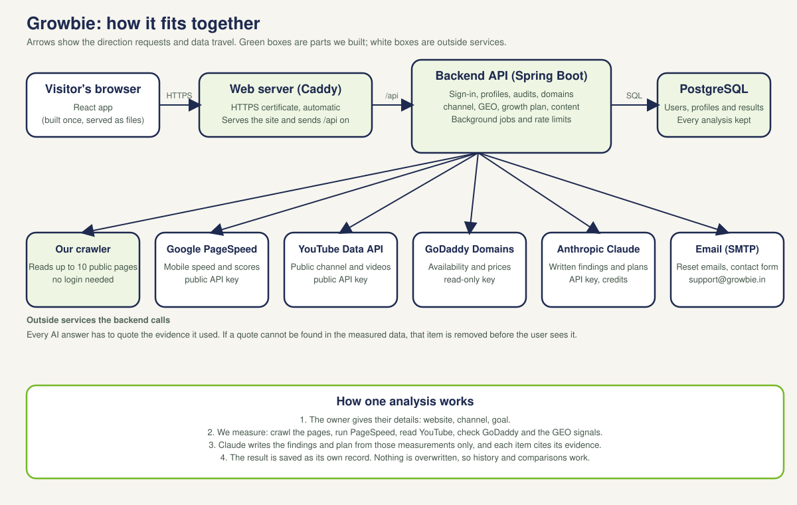

# Growbie

**You've got the business. We've got your back.**

Growbie is a plain-language advisor for small businesses. Tell it about your business, and it checks your website, how well AI search tools can understand you, and your YouTube channel if you have one. Then it tells you what to fix first, shows you the evidence, and drafts the new wording for you to approve.

It is built for two kinds of people:

- **Businesses that are already running**, with a website or a YouTube channel that could do more.
- **People planning to launch**, who want to get the basics right before they open.

Live at **https://growbie.in**

---

## What it does

| You | Growbie |
|---|---|
| Give it your website address | Reads up to 10 public pages and runs a set of plain checks |
| Give it your YouTube channel | Looks at your recent videos, Shorts and long videos separately |
| Give it your domain | Checks it still suits the business, and only suggests a change when there's a real reason |
| Ask what to do next | Ranks the fixes by impact and effort, with the evidence next to each one |
| Ask for wording | Drafts a few versions. You pick one, change it if you like, and paste it in yourself |

Every result is saved on its own. Run the checks again later and you can see what's fixed, what's still there, and what's new.

## An example

A skincare brand gives Growbie its website. The homepage title is "Example Domain", which is what the site shows before someone has set it up. Growbie:

1. Quotes that exact title from the page.
2. Ranks "replace the title" as a quick, high-impact fix.
3. Drafts a title that names the business and what it sells, with a short reason.
4. Waits for you to approve it. Nothing is published.

## What it won't do

- **Make up numbers.** Sales, traffic and AI search results are never invented. If we can't measure something, it says "unavailable".
- **Promise results.** Nobody can promise a ranking, a view count or a place in AI answers.
- **Act for you.** It doesn't publish, buy, edit or change anything on your behalf. You do that yourself.
- **Treat missing information as a failure.** "Not provided" and "not applicable" are shown as exactly that.

## Where the information comes from

Each piece of information carries a label, so you can tell where it came from:

- **Observed:** measured from public pages, Google PageSpeed, or YouTube's public data.
- **You told us:** what you typed in.
- **AI-suggested:** written by an AI from the measured evidence. Always worded as a suggestion, never as fact.
- **Unavailable:** we can't get it, such as YouTube watch time, so it's shown struck through.



## The parts

| Part | What it is |
|---|---|
| `frontend/` | The website you see. React and Vite. |
| `backend/` | The server. Spring Boot and Java 21. Talks to the database and the outside services. |
| `backend/src/main/resources/prompts/` | The instructions given to the AI. Plain text, one file per task. |
| `backend/src/main/resources/db/migration/` | Database changes, applied in order when the server starts. |
| `design/` | The design prototypes, kept for reference. |
| `docs/` | Notes on the product, the deployment steps and the architecture diagram. |
| `scripts/` | Helper scripts: backups and quick checks for each feature. |

Outside services it uses:

- **Anthropic Claude** for the written findings, plans and wording.
- **Google PageSpeed Insights** for the mobile speed and quality scores.
- **YouTube Data API** for public channel and video information.
- **GoDaddy Domains** for availability and indicative prices. Read-only: it never buys a domain.
- **Email** for password resets and the contact form.

## Running it on your computer

You need Java 21, Node 22 and Docker.

1. **Start the database:**
   ```bash
   docker compose up -d
   ```
2. **Copy the settings file and fill it in:**
   ```bash
   cp .env.example .env
   ```
   Each setting is described in the file. Keep `.env` private. It's already ignored by git.
3. **Start the backend:**
   ```bash
   cd backend
   ./mvnw spring-boot:run
   ```
4. **Start the website** in another terminal:
   ```bash
   cd frontend
   npm install
   npm run dev
   ```
5. Open http://localhost:5173.

Some features need API keys. Without them, the rest still works, and the screens say what's missing.

## Tests

```bash
cd backend
./mvnw test
```

The tests cover the URL checks, the crawler's safety rules, the comparison logic, the password reset and the contact form.

## Putting it on a server

See [docs/DEPLOY.md](docs/DEPLOY.md). In short: the production setup runs three containers (the website and web server, the API, and the database) and gets its HTTPS certificate automatically. Only the web ports are open to the internet. The database is never exposed.

## Safety notes

- The crawler respects `robots.txt`, reads only public pages on the same site, and blocks private network addresses.
- Passwords are stored as hashes. Reset links work once and expire after 30 minutes.
- Secrets live in environment files, which are never committed.

## Status

Built for a hackathon, and still moving. Known gaps:

- Instagram is not connected yet. Meta's approval process is the main blocker.
- AI search testing isn't run yet. The GEO page says so.
- YouTube watch time and retention need the channel owner's permission through YouTube Analytics. That isn't set up.

## Contact

Questions, feedback or something broken: **support@growbie.in**, or use the contact form on the site.

## Licence

Not decided yet. Until it is, all rights are reserved.
